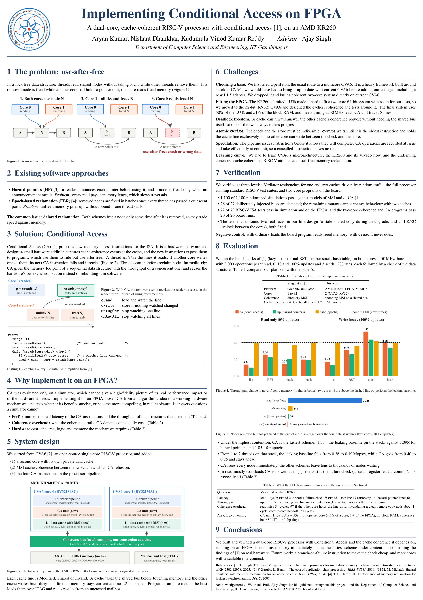

# Implementing Conditional Access on FPGA
A dual-core, cache-coherent RISC-V processor (CVA6) with the Conditional Access instructions for immediate memory reclamation, running on an AMD KR260 FPGA.

**Status:** ✅ completed
**Maintainers:** @AceAryan
**Started:** August 2026

Team: Aryan Kumar, Nishant Dhankhar, Kudumula Vinod Kumar Reddy. Advisor: Prof. Ajay Singh, Department of Computer Science and Engineering, IIT Gandhinagar.



## Why
In lock-free data structures, a thread can read a node that another thread has just freed: a **use-after-free**. Software fixes (hazard pointers, epoch-based reclamation) either slow every read or delay freeing memory. **Conditional Access** (Singh, Brown, Spear, [arXiv 2302.12958](https://arxiv.org/abs/2302.12958)) reuses the cache-coherence protocol, which already notices when another core writes a line you have read, to warn the reader. Nodes can then be freed **immediately**. The paper evaluated it only in a simulator; we built it in real hardware. [More background](docs/01_background.md).

## Quickstart
```bash
# 1. Clone with the CVA6 fork (submodule) and all its dependencies
git clone --recursive https://github.com/turing-house-community/multicore-on-fpga.git
cd multicore-on-fpga/cva6

# 2. Install the tools: RISC-V GCC, Verilator, Spike (once; see docs/00_getting_started.md)

# 3. Two caches + coherence bus + CA units, random traffic against reference models (~2 min)
mkdir -p build
verilator --binary --timing -j 8 -Wno-fatal -Wno-lint -Wno-style -Wno-UNOPTFLAT \
  --top-module std_nbdcache_2core_tb -Mdir build/tb2 -f core/cache_subsystem/test/std_nbdcache_2core_tb.f
build/tb2/Vstd_nbdcache_2core_tb +seed=1 +nrandom=1500          # prints PASSED

# 4. Two complete cores running the CA test program (~10 min build)
make verilate target=cv32a6_imac_sv32_wb defines=CVA6_2CORE ver-library=work-ver-2core
riscv64-unknown-elf-gcc -march=rv32ima_zicsr -mabi=ilp32 -nostdlib -nostartfiles \
  -T verif/tests/custom/ca_2core/link.ld verif/tests/custom/ca_2core/ca_2core.S -o build/ca_2core.elf
LD_LIBRARY_PATH=tools/spike/lib work-ver-2core/Variane_testharness build/ca_2core.elf   # *** SUCCESS ***

# 5. On a KR260 with the prebuilt bitstream (see docs/04_fpga_kr260.md for setup)
mkdir -p $KR260_WIN_DIR/out && cp ../prebuilt/cva6_kr260.{bit,xsa} $KR260_WIN_DIR/out/
corev_apu/fpga/kr260/sw/build_tests.sh build/board
KR260_PROGRAM=1 corev_apu/fpga/kr260/kr260_run.sh build/board/ca_2core.elf 30            # RESULT PASS
```
Keep the repository inside the Linux/WSL file system (not `/mnt/c/...`), or builds get very slow.

## Where we are
**What works:** everything we set out to build.

Starting from the open-source single-core [CVA6](https://github.com/openhwgroup/cva6) RISC-V processor (32-bit, RV32IMAC):
1. **A second core** with its own private L1 data cache.
2. **MSI cache coherence** between the two write-back caches, over a small snooping bus.
3. **The four CA instructions** in the pipeline: `cread`, `cwrite`, `untagOne`, `untagAll`, with a failure flag in CSR 0xCC0.
4. **The system on an AMD KR260**: both cores at 50 MHz using the board's DDR, programs loaded over JTAG.

Then we verified it (randomized testbenches, injected bugs, ISA tests, on-board tests) and ran the paper's benchmarks on the board. [How the hardware works](docs/02_design.md).

| | |
|---|---|
| **Memory** | CA frees every removed node immediately: **0** unfreed nodes, vs. 100–200 for epochs and 1,500–3,000 for never freeing |
| **Throughput** | fastest scheme under high contention: **1.33×** the never-freeing baseline on a stack (hazard pointers 1.09×, epochs 1.05×); slower on read-heavy work because the failure check is a CSR read |
| **Latency** | `cread` 2 cycles (plain load 1); `cread` + failure check 7; `cread` + `cwrite` 17 (`amoswap` 14) |
| **Coherence cost** | plain miss 54 cycles, miss to a line the other core holds dirty 97, invalidating a clean copy ~1 |
| **Area** | CA unit ~1,100 LUTs per core (4.5% of a core), no block RAM; coherence bus 48 LUTs |
| **Correctness** | 1,100/1,100 randomized simulations, 26/27 injected bugs caught, 72/73 ISA tests, 288/288 benchmark runs valid; board = simulation |

Details: [docs/06_results.md](docs/06_results.md).

**What's next:** the 🙋 ideas in [PLAN.md](PLAN.md#stretch--ideas); the most valuable is a branch-on-CA-failure instruction, which would remove most of CA's read-side cost.

**Open questions:** whether CA state should survive interrupts and context switches, and snooping vs. directory for 4+ cores. Details live in [PLAN.md](PLAN.md).

## How to join
1. Read this README, then skim [LOG.md](LOG.md) to see how we got here.
2. Pick a task marked 🙋 in [PLAN.md](PLAN.md) (or ask a maintainer). To get set up, do [getting started](docs/00_getting_started.md) and the first two levels of [the simulation guide](docs/03_simulation.md).
3. Ping us on [Discord](https://discord.com/channels/1552005581009846404/1561748566366617630).

## Resources
- Singh, Brown, Spear: *Efficient Hardware Primitives for Immediate Memory Reclamation in Optimistic Data Structures*, [arXiv 2302.12958](https://arxiv.org/abs/2302.12958)
- [CVA6](https://github.com/openhwgroup/cva6) and its [user manual](https://docs.openhwgroup.org/projects/cva6-user-manual/)
- Nagarajan, Sorin, Hill, Wood: *A Primer on Memory Consistency and Cache Coherence* (2nd ed.)
- [AMD Kria KR260 Robotics Starter Kit](https://www.amd.com/en/products/system-on-modules/kria/k26/kr260-robotics-starter-kit.html)

## Guides
| # | Guide | You will |
|---|---|---|
| 0 | [Getting started](docs/00_getting_started.md) | install the tools and do a first run |
| 1 | [Background](docs/01_background.md) | understand the problem and Conditional Access |
| 2 | [Hardware design](docs/02_design.md) | understand MSI, the bus, the CA unit |
| 3 | [Simulation](docs/03_simulation.md) | verify everything without a board |
| 4 | [FPGA (KR260)](docs/04_fpga_kr260.md) | build the bitstream and run on the board |
| 5 | [Benchmarks](docs/05_benchmarks.md) | rerun the paper's evaluation |
| 6 | [Results](docs/06_results.md) | see what we measured |
| 7 | [Challenges](docs/07_challenges.md) | learn from our mistakes and decisions |
| 8 | [In depth](docs/08_in_depth.md) | the full technical explanation, and answers to reviewers' questions |
| – | [Code map](docs/code_map.md) | find every file we changed in CVA6 |

## Repository layout
| Path | What |
|---|---|
| `cva6/` | **submodule**: our CVA6 fork ([AceAryan/cva6](https://github.com/AceAryan/cva6), branch `ca-snoop`) with all RTL, tests, FPGA scripts and benchmarks |
| `docs/` | the guides above, the poster (`talks/`) and demos |
| `prebuilt/` | the KR260 bitstream and hardware platform, with Vivado reports |
| `results/` | raw board output of all measurements, decoded tables and charts |
| `PLAN.md` | what was done, and open tasks for newcomers (🙋) |
| `LOG.md` | how we got here: what was tried, what broke, why decisions were made |
| `project.yml` | metadata for the Turing House dashboard |

## Acknowledgements
We thank Prof. Ajay Singh for his guidance throughout this project, and the Department of Computer Science and Engineering, IIT Gandhinagar, for access to the AMD KR260 board and tools.

## License
This repository's own content is under the Apache License 2.0 ([LICENSE](LICENSE)). The CVA6 code in `cva6/` keeps its own licenses (mostly Solderpad Hardware License 2.0); see the files there.

---
Part of the [Turing House Community](https://github.com/turing-house-community), IITGN CSE.
