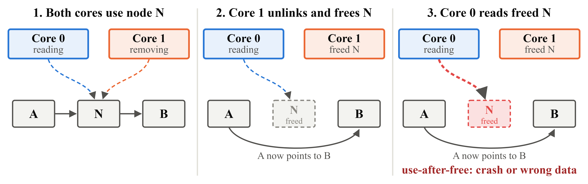
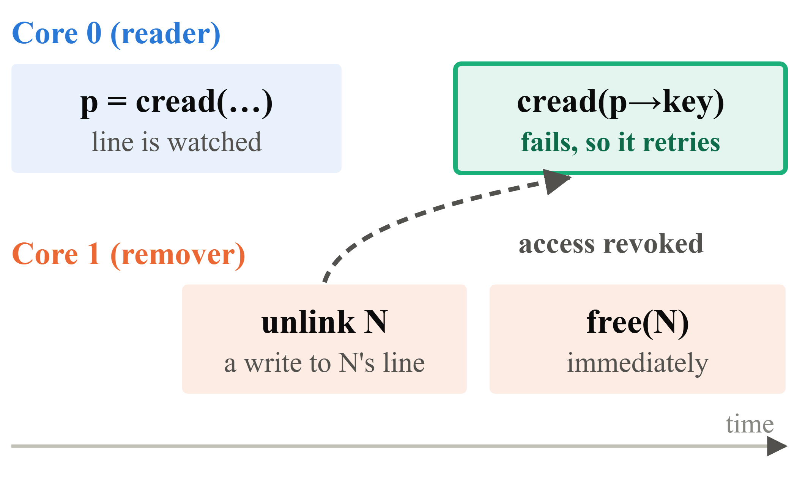
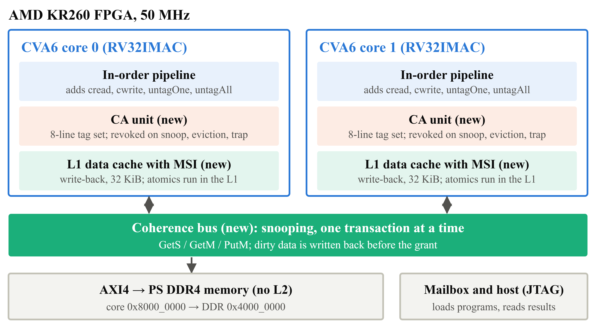

# 1. Background: why Conditional Access exists

This page explains the problem the project solves. No hardware knowledge needed.

## The problem: use-after-free in lock-free data structures

In a **lock-free** (or *optimistic*) data structure, threads read shared nodes **without taking locks**, while other threads insert and remove nodes at the same time. This is fast, but it creates a danger. Take a sorted linked list:



1. Core 0 is walking the list and holds a pointer to node N. Core 1 also reaches N.
2. Core 1 deletes N: it unlinks it from the list and **frees** its memory.
3. Core 0 still has its pointer and reads N's fields. N is freed memory now, possibly already reused for something else. Core 0 reads garbage or crashes. This is a **use-after-free**.

Core 1 could not know that core 0 was still looking at N. So the real question is: **when is it safe to free a removed node?**

## Existing software approaches

| Scheme | How it works | Problem |
|---|---|---|
| **Hazard pointers (HP)** | Before using a pointer, a reader announces it in a shared "hazard" slot. A node is freed only when no slot names it. | Every read must publish the pointer and wait for it to be visible (a memory fence). That makes traversals slow. |
| **Epoch-based reclamation (EBR, QSBR, RCU)** | Removed nodes go into a "limbo" list. They are freed in batches once every thread has passed a quiescent point (finished its operation). | Unfreed memory piles up. If one thread stalls, nothing can be freed at all. |

**The common issue is delayed reclamation.** Both schemes free a node only some time after it is removed, so they trade speed (HP) against memory (EBR). A leaky program that never frees anything is the fastest, and the most wasteful.

## The solution: Conditional Access (CA)

The paper *Efficient Hardware Primitives for Immediate Memory Reclamation in Optimistic Data Structures* (Singh, Brown, Spear, [arXiv 2302.12958](https://arxiv.org/abs/2302.12958)) observes that the hardware **already knows** when another core changes a line you have read: the **cache-coherence protocol** has to tell your cache, so your copy can be invalidated.

CA is a **hardware–software co-design**:
- **Hardware:** a small unit next to the L1 data cache watches a few cache lines per core and notices when coherence takes one of them away.
- **Software:** four new instructions expose that information to programs.

| Instruction | Meaning |
|---|---|
| `cread` | load a value **and watch** its cache line |
| `cwrite` | store a value **only if** nothing watched has changed (check and store in one atomic step) |
| `untagOne` | stop watching one line |
| `untagAll` | stop watching all lines, and clear the failure flag |



Before freeing a node, the remover writes to it (it marks it deleted). That write needs exclusive ownership of the line, so coherence **invalidates the reader's copy**, and the CA unit **revokes** the reader's access. The reader's next `cread` fails, and it restarts from the head of the list instead of using the freed node. So the remover can call `free()` **immediately**.

A list search with CA, simplified from the paper:
```c
retry:
  untagAll();
  pred = cread(&head);                 /* read and watch          */
  curr = cread(&pred->next);
  while (cread(&curr->key) < key) {
      if (ca_failed()) goto retry;     /* a watched line changed  */
      pred = curr;  curr = cread(&curr->next);
  }
```

**Result:** the memory footprint of a sequential data structure with the throughput of a concurrent one, by reusing the hardware's own synchronization instead of rebuilding it in software.

## Why build it on an FPGA?

The paper evaluated CA only on a **simulator** (Graphite, up to 32 simulated cores). A simulator cannot say:
- what the instructions **really cost** in a real pipeline (latency, throughput)
- what the coherence traffic CA depends on **actually costs**
- how much **area, logic and memory** the mechanism needs

Building it on real hardware turns CA from an algorithmic idea into a working mechanism, and checks whether its benefits survive. Our answers to these three questions are in [the results](06_results.md).

## What we built

Starting from **CVA6**, an open-source single-core RISC-V processor, we added:
1. a **second core** with its own private L1 data cache;
2. **MSI cache coherence** between the two caches, which CA relies on;
3. the **four CA instructions** in the processor pipeline;

and ran the whole system on an **AMD KR260** FPGA board.



Next: [how the hardware works](02_design.md).

## Further reading
- Singh, Brown, Spear. *Efficient Hardware Primitives for Immediate Memory Reclamation in Optimistic Data Structures.* [arXiv 2302.12958](https://arxiv.org/abs/2302.12958). **Read this first**, especially sections 1–4.
- Michael. *Hazard Pointers: Safe Memory Reclamation for Lock-Free Objects.* IEEE TPDS, 2004.
- Hart, McKenney, Demke Brown, Walpole. *Performance of Memory Reclamation for Lockless Synchronization.* JPDC, 2007 (compares epoch-based schemes, QSBR and hazard pointers).
- Nagarajan, Sorin, Hill, Wood. *A Primer on Memory Consistency and Cache Coherence* (2nd ed.), chapters 6–7 (snooping MSI). Free from Morgan & Claypool / Synthesis Lectures.
- Zaruba, Benini. *The Cost of Application-Class Processing: Energy and Performance Analysis of a Linux-Ready 1.7-GHz 64-Bit RISC-V Core in 22-nm FDSOI Technology.* IEEE TVLSI, 2019 (the CVA6, formerly Ariane, paper).
