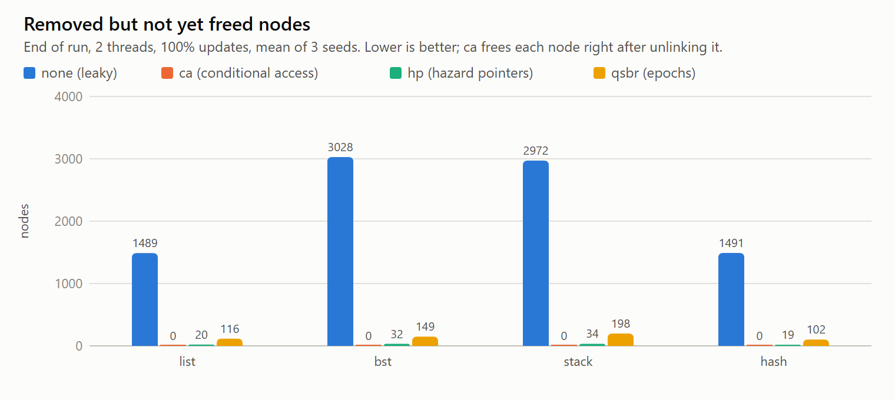
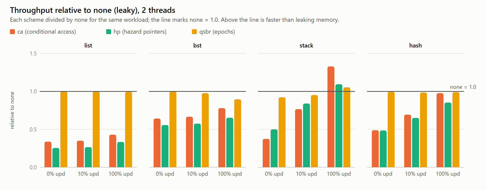

# 6. Results: what the FPGA measured

All numbers come from the KR260: two CVA6 cores at 50 MHz, 16-byte cache lines, 32 KiB L1 data cache per core, no L2, DDR behind the ARM side. The raw data is in [`results/`](../results/), with the full write-up in [`results/BENCHMARK_SUMMARY.md`](../results/BENCHMARK_SUMMARY.md). [Benchmarks](05_benchmarks.md) explains how to rerun everything.

**Compare ratios, not absolute numbers.** The clock is slow and every miss goes to DDR, so absolute throughput is low. What matters is how the schemes compare to each other on the same hardware.

## Our setup vs. the paper's
| | Paper (Singh, Brown, Spear) | This work |
|---|---|---|
| Platform | Graphite simulator | AMD KR260 FPGA, real RTL |
| Cores | 1–32 simulated | 2 × CVA6 RV32IMAC, 50 MHz |
| Coherence | directory MSI | snooping MSI on a shared atomic bus |
| Caches | 64 B lines, 32 KiB L1 + 256 KiB shared L2 | 16 B lines, 32 KiB L1, no L2 |
| CA failure check | a flag register (free) | CSR read `csrr 0xCC0` |

## 1. Correctness
| Check | Result |
|---|---|
| Randomized cache testbenches against models of MSI and CA | 1,100 / 1,100 pass |
| Injected bugs (mutants) detected | 26 / 27 (the one missed cannot change behaviour with 2 caches) |
| RISC-V ISA tests, simulation and board | 72 / 73 (`rv32mi-p-breakpoint` fails, disabled upstream too) |
| Two-core coherence and CA programs on the board | 20 / 20 runs pass |
| Benchmark runs on the board | 288 / 288 valid: no scheme ever corrupted a data structure |
| Negative control | with plain loads instead of `cread`, the board program reads freed memory; with `cread` it never does |
| Board vs. simulation | no difference found |

## 2. Memory: CA frees immediately
Nodes removed but **not yet freed** at the end of a run (2 threads, 100% updates):

| | `none` | **`ca`** | `hp` | `qsbr` |
|---|---|---|---|---|
| list | 1,489 | **0** | 20 | 116 |
| BST | 3,028 | **0** | 32 | 149 |
| stack | 2,972 | **0** | 34 | 198 |
| hash | 1,491 | **0** | 19 | 102 |

This is the paper's central claim, reproduced: with CA, memory use is that of a sequential data structure.

## 3. Throughput
Throughput relative to the leaky `none` (2 threads; higher is better; 1.00 = as fast as never freeing):

| | read-only (0% updates) | 100% updates |
|---|---|---|
| list: ca / hp / qsbr | 0.34 / 0.25 / 1.00 | 0.43 / 0.33 / 1.00 |
| BST: ca / hp / qsbr | 0.64 / 0.56 / 1.00 | 0.78 / 0.65 / 0.90 |
| stack: ca / hp / qsbr | 0.37 / 0.50 / 0.92 | **1.33** / 1.09 / 1.05 |
| hash: ca / hp / qsbr | 0.49 / 0.48 / 0.99 | **0.98** / 0.85 / 0.99 |

**What matches the paper:**
1. CA is slower than epoch-based schemes for read-only work.
2. CA is the **best scheme under high contention**: on the stack at 100% updates it beats even the leaky baseline (1.33×) and both other schemes. With 2 threads, `none` drops from 0.36 to 0.19 Mops/s because both threads fight over the stack's `top` line through LR/SC; CA drops less, from 0.40 to 0.25.
3. Hazard pointers are generally the slowest (a fence on every read).
4. CA frees memory immediately (section 2).

**Why CA reads cost more here than in the paper:** the failure check is a CSR read, and CVA6 executes CSR reads only when they commit. So `cread` + check costs 7 cycles instead of 2 (section 4). A list hop does two of them. The paper assumed a free flag register. A *branch-on-CA-failure* instruction would remove most of this cost; it is the top item in [PLAN.md](../PLAN.md).

## 4. Latency of the instructions
Measured with `micro.c`, one core, all accesses hit in the L1:

| Operation | Cycles |
|---|---|
| plain load | 1.0 |
| `cread` | 2.0 |
| `cread` + failure check (`csrr 0xCC0; andi`) | 7.0 |
| `untagAll` | 4.0 |
| `untagOne` | 0 (hidden in the pipeline) |
| `cread` + `cwrite` (the try-lock pattern) | 17 |
| `amoswap.w` (atomic swap in the L1) | 14 |
| `lr.w` + `sc.w` | 24 |
| `fence rw,rw` (what hazard pointers pay per read) | 6 |

Source: [`results/micro.md`](../results/micro.md).

## 5. Cost of coherence
Measured with `micro_coh.c`, two cores, 256 fresh lines per test, mean of 3 runs (spread under 0.2%). The values include about 6.5 cycles of loop overhead per line.

| Access | Cycles per line |
|---|---|
| read miss, no other copy (refill from DDR) | 53.7 |
| read miss, the other core holds the line **Modified** | 96.9 |
| write to a Shared line the other core also holds (invalidate it) | 50.4 |
| write to a Shared line nobody else holds | 49.5 |
| one-way handoff of a line between the cores (ping-pong) | 150.6 |
| read hit (reference) | 6.5 |

- Taking a line the other core holds dirty costs about **43 extra cycles**, roughly 1.8× a plain miss, because the dirty data must reach DDR first (there is no cache-to-cache transfer).
- **Invalidating** a remote clean copy costs about **1 cycle**: the snoop finds the line clean and answers at once. This invalidation is exactly the event CA listens to, so CA's signal is almost free.
- A full handoff between the cores is about 150 cycles (3 µs).

Source: [`results/micro_coh.md`](../results/micro_coh.md).

## 6. Hardware cost
From Vivado's post-implementation report ([`prebuilt/reports/impl_utilization_hier.rpt`](../prebuilt/reports/impl_utilization_hier.rpt)):

| Block | LUTs | Registers | Block RAM |
|---|---|---|---|
| CA unit (`ca_tag_set`), per core | ~1,100 (4.5% of a core, 1% of the FPGA) | ~540 | 0 |
| Coherence bus (`cc_bus`) | 48 | 40 | 0 |
| One CVA6 core with its caches | ~25,000 | – | 41 |
| Whole design | 58,853 (50%) | 32,058 (14%) | 74 (51%) |

CA needs **no memory blocks** and about 1,100 LUTs per core: 8 tag comparators, the pending table and the revocation logic.

## Caveats
- **Two cores on an atomic bus.** Contention is much milder than in the paper's 32-thread runs.
- **16-byte lines.** A node is exactly one line, so there is no false sharing between nodes. The paper used 64-byte lines.
- **No L2.** Every miss goes to DDR.
- **Not implemented:** the paper's `ibr`, `he` and `rcu` baselines; `qsbr` stands in for the epoch family.
- **BST with 1 thread still sees CA failures** (about 25 per run): tagged lines get evicted because a 10K-key tree does not fit the L1. The paper mentions the same eviction caveat.
