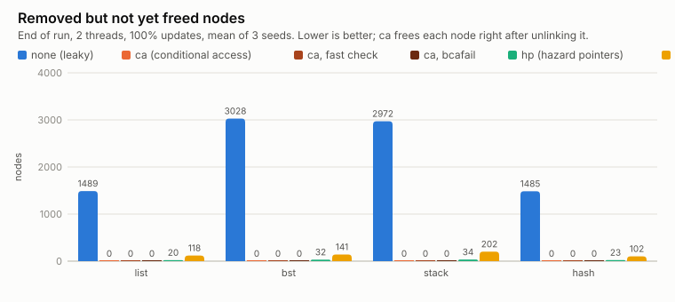
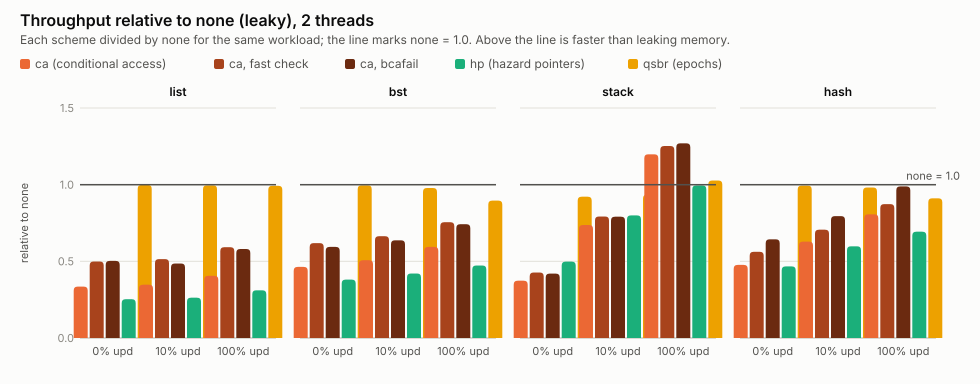

# 6. Results: what the FPGA measured

All numbers come from the KR260 unless marked otherwise: two CVA6 cores at 50 MHz, a 32 KiB L1 data cache per core with 16-byte lines, a directory, a shared 256 KiB L2 with 64-byte lines, and DDR behind the ARM side. The raw data is in [`results/`](../results/), with a compact write-up in [`results/BENCHMARK_SUMMARY.md`](../results/BENCHMARK_SUMMARY.md). [Benchmarks](05_benchmarks.md) explains how to rerun everything.

**Compare ratios, not absolute numbers.** The clock is slow, so absolute throughput is low. What matters is how the schemes compare with each other on the same hardware.

We built the system in steps, and measured after each one:
1. **First design:** snooping bus, no L2, failure check through the CSR ([`results/phase5/`](../results/phase5/)).
2. **Directory and `bcafail`:** a directory instead of the bus, and two cheaper failure checks ([`results/no_l2/`](../results/no_l2/), [`results/bus/`](../results/bus/)).
3. **Final:** the same plus a shared L2 ([`results/board/`](../results/board/)).

Unless a section says otherwise, the numbers below are from the final design.

## Our setup vs. the paper's
| | Paper (Singh, Brown, Spear) | This work |
|---|---|---|
| Platform | Graphite simulator | AMD KR260 FPGA, real RTL; also a cycle-exact simulation of it |
| Cores | 1–32 simulated | 2 × CVA6 RV32IMAC, in-order, 50 MHz |
| Coherence | directory MSI | directory MSI |
| Caches | 64 B lines, 32 KiB L1 + 256 KiB shared L2 | 16 B L1 lines, 32 KiB L1 + 256 KiB shared L2 (64 B lines) |
| CA failure check | a flag register (free) | CSR read, fast check, or our `bcafail` branch |

## 1. Correctness
| Check | Result |
|---|---|
| Randomized two-cache testbench against models of MSI and CA (bus and directory) | 1,500 / 1,500 runs pass |
| Injected bugs (mutants) detected | 26 / 27 (the one missed cannot change behaviour with 2 caches) |
| L2 testbench (random traffic, slow and stalling DDR, reset with dirty lines) | 200 / 200 runs pass |
| RISC-V ISA tests, simulation and board | 72 / 73 (`rv32mi-p-breakpoint` fails; disabled upstream too) |
| `msi_2core`, `ca_2core`, `bcafail` on the board | pass; `bcafail` agreed with the CSR in all 2,000 rounds |
| Benchmark runs on the board, all designs | 1,800 / 1,800 valid: no scheme ever corrupted a data structure |
| Negative control | with plain loads instead of `cread`, the board program reads freed memory; with `cread` it never does |
| Board vs. simulation | final design: identical cycle counts in all 144 benchmark configurations |

## 2. Memory: CA frees immediately
Nodes removed but **not yet freed** at the end of a run (2 threads, 100% updates):

| | `none` | **`ca`** | `hp` | `qsbr` |
|---|---|---|---|---|
| list | 1,489 | **0** | 20 | 118 |
| BST | 3,028 | **0** | 32 | 141 |
| stack | 2,972 | **0** | 34 | 202 |
| hash | 1,485 | **0** | 23 | 102 |

This is the paper's central claim, reproduced: with CA, memory use is that of a sequential data structure. All three CA variants give 0.

## 3. Throughput
Throughput relative to the leaky `none` (2 threads; higher is better; 1.00 = as fast as never freeing). "Best CA" is the better of `cafast` and `cabr`:

| | read-only (0% updates) | 100% updates |
|---|---|---|
| list: best CA / hp / qsbr | 0.50 / 0.25 / **1.00** | 0.59 / 0.31 / **0.99** |
| BST: best CA / hp / qsbr | 0.62 / 0.38 / **1.00** | 0.76 / 0.47 / **0.90** |
| stack: best CA / hp / qsbr | 0.43 / 0.50 / **0.92** | **1.27** / 0.99 / 1.03 |
| hash: best CA / hp / qsbr | 0.64 / 0.47 / **0.99** | **0.99** / 0.69 / 0.91 |

**What matches the paper:**
1. CA is slower than epoch-based reclamation on read-mostly work.
2. CA is the **best scheme under high contention**: on the stack at 100% updates it beats both other schemes and even the leaky baseline (1.27×). On the hash table it is ahead of epochs (0.99 vs 0.91).
3. Hazard pointers are generally the slowest (a fence on every read).
4. CA frees memory immediately (section 2).

### How the failure check changes CA's speed
| | `ca` (CSR) | `cafast` | `cabr` (`bcafail`) |
|---|---|---|---|
| list 0% / 100% | 0.34 / 0.41 | **0.50** / **0.59** | 0.50 / 0.58 |
| BST 0% / 100% | 0.46 / 0.59 | **0.62** / **0.76** | 0.59 / 0.74 |
| stack 0% / 100% | 0.37 / 1.20 | **0.43** / 1.25 | 0.42 / **1.27** |
| hash 0% / 100% | 0.48 / 0.81 | 0.56 / 0.87 | **0.64** / **0.99** |

Both cheaper checks help a lot: up to 1.5× over the CSR on the list. `bcafail` wins where failures are common (stack, hash at 100% updates). The fast check is slightly better on the list and the BST, which do long chains of reads with few failures.

## 4. What the shared L2 changed
The same 432 runs with and without the L2 (`results/no_l2/` vs `results/board/`):

| | `none` faster with the L2 by | best CA vs `none`: no L2 → L2 | fastest scheme: no L2 → L2 |
|---|---|---|---|
| list 100% | 1.10× | 0.61 → 0.59 | qsbr → qsbr |
| BST 0% | 1.48× | 0.71 → 0.62 | qsbr → qsbr |
| BST 100% | 1.46× | 0.83 → 0.76 | qsbr → qsbr |
| stack 100% | 2.26× | 1.37 → 1.27 | cafast → cabr |
| hash 100% | 1.70× | 1.01 → 0.99 | cabr → cabr |

- Everything gets faster, most of all the contended structures, because core-to-core handoffs no longer go through DDR.
- CA's ratios drop a little. Without an L2, every miss went to DDR, and those slow misses hid part of CA's extra per-read work.
- On the stack, CA's lead over `none` shrinks (1.37 → 1.27). Part of that lead came from `none` allocating fresh nodes that miss in the cache, and the L2 makes those misses cheaper.
- The winners stay the same: CA under contention, epochs on read-heavy work.

## 5. Directory vs. bus
Same design without the L2, board (`results/bus/directory_vs_bus.md`): relative to `none` the two are almost identical. In cycles per operation the directory is up to **17% faster** when both cores miss on different lines at the same time (BST and hash at 100% updates). It is never more than 2% slower.

## 6. Latency of the instructions
Measured with `micro.c`, one core, all accesses hit in the L1:

| Operation | Cycles |
|---|---|
| plain load | 1.0 |
| `cread` | 2.0 |
| `cread` + CSR check (`csrr 0xCC0; andi`) | 7.0 |
| `cread` + fast check | 5.0 |
| `cread` + `bcafail` | 4.0 |
| `untagAll` | 4.0 |
| `untagOne` | 0 (hidden in the pipeline) |
| `cread` + `cwrite` (the try-lock pattern) | 15 |
| `amoswap.w` (atomic swap in the L1) | 12 |
| `lr.w` + `sc.w` | 22 |
| `fence rw,rw` (what hazard pointers pay per read) | 6 |

Source: [`results/micro/`](../results/micro/README.md).

## 7. Cost of coherence
Measured with `micro_coh.c`, two cores, 256 fresh lines per test. The values include about 6.5 cycles of loop overhead.

| Access | with L2 | without L2 |
|---|---|---|
| read miss, no other copy | 32.8 | 53.7 |
| read miss, the other core holds the line **Modified** | 32.1 | 96.9 |
| write to a Shared line the other core also holds (invalidate it) | 20.0 | 50.4 |
| one-way handoff of a line between the cores (ping-pong) | 59.0 | 150.6 |
| read hit (reference) | 6.3 | 6.5 |

- Without the L2, taking a line the other core holds dirty cost about 43 extra cycles, because the dirty data had to reach DDR first (there is no cache-to-cache transfer). With the L2 that data waits in the L2, so it costs no more than a plain miss.
- **Invalidating** a remote clean copy is almost free: the snoop finds the line clean and answers at once. This invalidation is exactly the event CA listens to, so CA's signal costs almost nothing.

## 8. Hardware cost
From Vivado's post-implementation report ([`prebuilt/reports/impl_utilization_hier.rpt`](../prebuilt/reports/impl_utilization_hier.rpt)):

| Block | LUTs | Memory |
|---|---|---|
| CA unit (`ca_tag_set`), per core | ~1,000 (4% of a core, under 1% of the FPGA) | none |
| `bcafail` | 17 in total | none |
| Directory (`cc_directory`) | 676 | 2 UltraRAM |
| Shared L2 (`axi_l2_cache`) | 18,508 | 8 UltraRAM, 8 small block RAMs |
| One CVA6 core with its caches | ~25,000 | – |
| Whole design | 78,120 (67%) | 78 block RAM tiles (54%), 10 UltraRAM |

CA needs no memory blocks and about 1,000 LUTs per core: 8 tag comparators, the pending table and the revocation logic. The L2 is by far the largest addition.

## 9. Compared with the paper
CA throughput relative to `none` at 100% updates. The paper has no 2-thread point, so we read its plotted line between the 1- and 4-thread points (`paper_interp_2t.py`, about ±15%):

| | paper, 2 threads (estimated) | our simulator | our board |
|---|---|---|---|
| list | 0.67 | 0.59 | 0.59 |
| BST | 0.97 | 0.76 | 0.76 |
| stack | 0.57 | 1.27 | 1.27 |
| hash | 1.08 | 0.99 | 0.99 |

- On the list and the hash table we are close to the paper.
- On the BST we are lower, which fits our more expensive failure check.
- The stack is the big difference: in the paper CA is slower than never freeing; on our in-order cores it is faster.
- The paper's biggest CA wins appear at 16–32 threads, where hazard pointers and epochs scale badly. With 2 cores we cannot test that.

The full comparison, with 4 and 32 threads and all schemes, is in [`results/paper_comparison.md`](../results/paper_comparison.md).

## Caveats
- **Two cores.** Contention is much milder than in the paper's 32-thread runs.
- **16-byte L1 lines.** A node is exactly one line, so there is no false sharing between nodes. The paper used 64-byte lines.
- **In-order cores at 50 MHz.** The paper simulated different cores; absolute numbers cannot be compared, only ratios.
- **Not implemented:** the paper's `ibr`, `he` and `rcu` baselines; `qsbr` stands in for the epoch family.
- **BST with 1 thread still sees CA failures** (about 27 per run): tagged lines get evicted, because a 10K-key tree does not fit the L1. The paper mentions the same eviction caveat.
