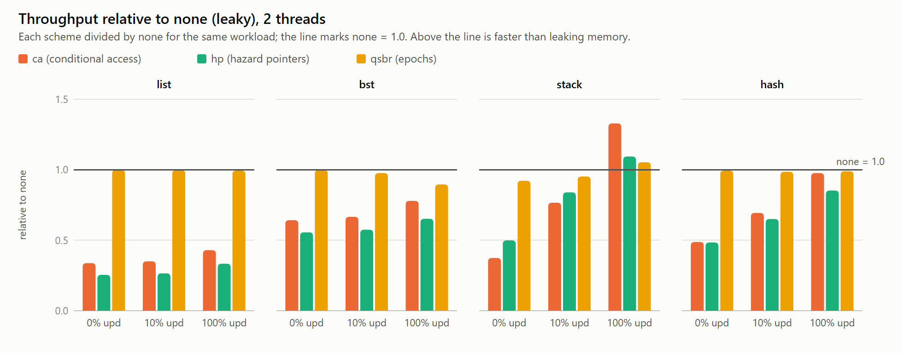

# Conditional access on the KR260 two-core CVA6: benchmark results

Date: 2026-11-02. Hardware: AMD KR260 (K26 SOM). Two CVA6 cores (cv32a6_imac_sv32_wb) with MSI-coherent write-back L1s and conditional access, PL clock 49.9995 MHz, bitstream from Phase 4 (unchanged). Paper: Singh, Brown, Spear, arXiv 2302.12958.

All 288 runs completed, and every data structure validated after every run (ordered, unmarked, size = prefill + successful inserts − successful deletes). **No scheme corrupted a structure.**

## What was run (following the paper's evaluation, scaled to 2 cores)
| | Paper | Here |
|---|---|---|
| Data structures | lazy list (1K keys), external BST (10K keys), Treiber stack, hash table (128 buckets of lazy lists) | the same |
| CA usage | Algorithms 1–3: cread on every shared read with CA_CHECK, untagOne while traversing, cread/cwrite try-lock, free immediately after unlink | the same. CA_CHECK = `csrr 0xCC0; andi 1` |
| Baselines | none, rcu, qsbr, ibr, hp, he | none (leaky), qsbr, hp. ibr/he/rcu were not implemented. |
| Reclamation parameters | scan after every 30 removals; epoch advance every 150 allocations | the same |
| Workload | 0%, 10%, 100% updates (inserts and deletes 50/50), random keys, 50% prefill, 3K ops per thread, mean of 3 runs | the same, at 1 and 2 threads (seeds 1, 2, 3) |
| Platform | Graphite simulator, 1–32 cores, directory MSI, 64B lines, 32K L1 + shared 256K L2 | FPGA, 2 cores, broadcast MSI on an atomic bus, 16B lines, 32K L1, no L2, DDR behind the PS |

**Throughput** is total operations divided by the slowest thread's `mcycle` time. **Unreclaimed** means nodes removed but not yet freed.

Sources: `cva6/corev_apu/fpga/kr260/sw/bench/`
- `bench.c`: all structures and schemes, selected at compile time
- `crt.S`
- `build_all.sh`
- `analyze.py`
- `micro.c`: primitive costs
- `micro_coh.c`: coherence costs

## Plots
Open `plots/index.html`, which shows all charts plus the data tables. Hovering a bar shows its value. The charts are also available separately as SVG and 2× PNG:

| Chart | Files |
|---|---|
| Throughput relative to `none`, 2 threads | `plots/relative_to_none_2threads.svg` / `.png` (start here) |
| Throughput per data structure | `plots/throughput_{list,bst,stack,hash}.svg` / `.png` |
| Removed-but-not-freed nodes | `plots/unreclaimed_nodes.svg` / `.png` |
| Primitive costs | `plots/primitive_costs.svg` / `.png` |

To regenerate (from `multicore-on-fpga/`): `python3 cva6/corev_apu/fpga/kr260/sw/bench/plot.py results`

## Results

### Throughput (Mops/s; in brackets, relative to `none`)

#### Lazy list (1K keys)
| updates | threads | none | ca | hp | qsbr |
|---|---|---|---|---|---|
| 0% | 1 | 0.028 | 0.009 (0.34) | 0.007 (0.25) | 0.028 (1.00) |
| 0% | 2 | 0.055 | 0.018 (0.34) | 0.014 (0.25) | 0.055 (1.00) |
| 10% | 1 | 0.026 | 0.009 (0.35) | 0.007 (0.26) | 0.026 (1.00) |
| 10% | 2 | 0.051 | 0.018 (0.35) | 0.014 (0.27) | 0.051 (1.00) |
| 100% | 1 | 0.022 | 0.009 (0.41) | 0.007 (0.31) | 0.022 (0.98) |
| 100% | 2 | 0.038 | 0.017 (0.43) | 0.013 (0.33) | 0.038 (1.00) |

#### External BST (10K keys)
| updates | threads | none | ca | hp | qsbr |
|---|---|---|---|---|---|
| 0% | 1 | 0.086 | 0.049 (0.56) | 0.041 (0.48) | 0.086 (1.00) |
| 0% | 2 | 0.145 | 0.093 (0.64) | 0.081 (0.56) | 0.145 (1.00) |
| 10% | 1 | 0.076 | 0.046 (0.60) | 0.039 (0.51) | 0.075 (0.98) |
| 10% | 2 | 0.132 | 0.088 (0.67) | 0.076 (0.57) | 0.129 (0.98) |
| 100% | 1 | 0.059 | 0.040 (0.69) | 0.034 (0.58) | 0.051 (0.87) |
| 100% | 2 | 0.098 | 0.077 (0.78) | 0.064 (0.65) | 0.088 (0.90) |

#### Treiber stack (1K elements)
| updates | threads | none | ca | hp | qsbr |
|---|---|---|---|---|---|
| 0% | 1 | 2.083 | 0.781 (0.38) | 1.041 (0.50) | 1.923 (0.92) |
| 0% | 2 | 4.169 | 1.561 (0.37) | 2.080 (0.50) | 3.843 (0.92) |
| 10% | 1 | 0.658 | 0.478 (0.73) | 0.530 (0.80) | 0.621 (0.94) |
| 10% | 2 | 1.015 | 0.778 (0.77) | 0.852 (0.84) | 0.967 (0.95) |
| 100% | 1 | 0.358 | **0.400 (1.12)** | 0.344 (0.96) | 0.212 (0.59) |
| 100% | 2 | 0.189 | **0.251 (1.33)** | 0.206 (1.09) | 0.199 (1.05) |

#### Hash table (128 buckets, 1K keys)
| updates | threads | none | ca | hp | qsbr |
|---|---|---|---|---|---|
| 0% | 1 | 0.740 | 0.315 (0.43) | 0.294 (0.40) | 0.729 (0.99) |
| 0% | 2 | 1.180 | 0.575 (0.49) | 0.571 (0.48) | 1.173 (0.99) |
| 10% | 1 | 0.403 | 0.259 (0.64) | 0.243 (0.60) | 0.405 (1.00) |
| 10% | 2 | 0.623 | 0.432 (0.69) | 0.405 (0.65) | 0.614 (0.99) |
| 100% | 1 | 0.224 | 0.181 (0.81) | 0.156 (0.70) | 0.193 (0.86) |
| 100% | 2 | 0.198 | **0.193 (0.98)** | 0.169 (0.85) | 0.196 (0.99) |

The spread between the 3 seeds is small (see `summary.csv`, `mops_spread_pct`).

### Memory: nodes removed but not yet freed (end of run, 2 threads, 100% updates)
| ds | none | ca | hp | qsbr |
|---|---|---|---|---|
| list | 1489 | **0** | 20 | 116 |
| bst | 3028 | **0** | 32 | 149 |
| stack | 2972 | **0** | 34 | 198 |
| hash | 1491 | **0** | 19 | 102 |

### CA failures (retries per run: revoked access or a lost try-lock)
| ds | updates | 1 thread | 2 threads |
|---|---|---|---|
| list | 0% / 10% / 100% | 0 / 0 / 0 | 0 / 12 / 156 |
| bst | 0% / 10% / 100% | 22 / 25 / 27 | 52 / 51 / 53 |
| stack | 0% / 10% / 100% | 0 / 0 / 0 | 0 / 79 / 4324 |
| hash | 0% / 10% / 100% | 0 / 0 / 0 | 0 / 4 / 44 |

- **BST failures with 1 thread** come from tagged lines being evicted, which is a cache capacity effect. A 10K-key tree does not fit the 32K L1 with 16B lines. This is the paper's associativity/eviction caveat.
- **Stack failures at 100% updates** come from both threads hammering the single `top` line.

### Primitive costs (`micro.c`, one hart, L1 hits)
| primitive | cycles |
|---|---|
| plain load | 1.0 |
| cread | 2.0 |
| cread + CAFAIL check (`csrr 0xCC0` + `andi`) | 7.0 |
| `csrr 0xCC0` alone | 1.0 |
| untagAll | 4.0 |
| cread + cwrite (try-lock) | 17 |
| amoswap.w (in-L1 AMO) | 14 |
| lr.w + sc.w | 24 |
| fence rw,rw (HP publication) | 6 |

### Coherence cost (`micro_coh.c`, two harts; details in `micro_coh.md`)
| access | cycles per line |
|---|---|
| read miss, no other copy | 53.7 |
| read miss, other core holds it Modified | 96.9 |
| write to Shared line, other core also has it | 50.4 |
| write to Shared line, no other copy | 49.5 |
| one-way line handoff between cores | 150.6 |
| read hit (loop reference) | 6.5 |

## Comparison with the paper's findings
1. **"In read-only workloads, CA is comparatively slower than rcu, qsbr and none."** Reproduced. QSBR runs at about `none`, and CA at 0.34–0.64 of it at 0% updates.
   - The gap is larger than in the paper. The microbenchmark shows why: in this implementation the CA_CHECK is a CSR read, which CVA6 executes at commit, so a cread followed by its check costs 7 cycles instead of 2. A list hop does two of them, about 14 cycles against 2 for plain loads.
   - The paper models CAFAIL as a flag register, which is essentially free. This is a cost of how CAFAIL is exposed, not of conditional access itself.
2. **"It even outperforms these algorithms in high contention scenarios (high updates and thread counts)."** Reproduced where contention is real.
   - On the stack at 100% updates, CA is the fastest scheme: 1.33× `none` at 2 threads, and better than HP (1.09×) and QSBR (1.05×).
   - On the hash table at 100% updates and 2 threads, CA equals `none` and QSBR (0.98) and beats HP (0.85).
   - The lists and the BST are long enough that the per-hop check cost dominates; their contention at 2 threads is low.
3. **Hazard pointers are slower** (per-read fence plus validation): reproduced. HP is the slowest scheme on the list, BST and hash table in every workload. Only on the read-only stack is it faster than CA.
4. **Memory:** "The CA scheme has a consistent reading of roughly 500 nodes that are allocated but not freed" (that is, only the live nodes), while other schemes accumulate more. Reproduced. CA had 0 removed-but-unfreed nodes at all times; QSBR 100–200; HP 19–34; leaky `none` 1.5K–3K.
5. **Scaling from 1 to 2 threads:** read-heavy workloads double for every scheme. At 100% updates on the stack, `none` drops from 0.36 to 0.19 Mops/s (contention on `top` through LR/SC and the atomic bus), while CA goes from 0.40 down to 0.25 and stays ahead.

## Caveats
- **Two cores and an atomic broadcast bus.** Contention effects are much milder than in the paper's 32-thread runs.
- **16-byte lines.** A node is exactly one line here, with no false sharing between nodes. The paper used 64-byte lines.
- **No L2.** Misses go to DDR through the PS at 50 MHz.
- **ibr, he and rcu were not implemented.** qsbr stands in for the RCU/epoch family.
- **3K operations per thread, as in the paper,** gives runs of 0.03–0.7 s. Absolute throughputs are low because of the 50 MHz clock and cache misses to DDR. The ratios are what matter.

## Possible next steps
- **Cheaper failure check:** a branch on CAFAIL, or cread reporting failure in a register, would remove most of the read-side overhead (from 7 cycles towards 2 per access). For example: a `bcafail` instruction, or a `cread` variant that sets rd to a sentinel and lets software skip the CSR read when the value is not the sentinel.
- **Longer runs and more seeds** for tighter error bars.

## Files (this folder)
| File | Contents |
|---|---|
| `raw/results.txt` | every run: config, seed, result, mailbox words |
| `runs.csv` | one row per run, decoded |
| `summary.csv` | means per configuration, with spread across seeds |
| `tables.md` | the tables above, generated by `analyze.py` |
| `micro.md`, `micro_raw.txt` | primitive costs |
| `micro_coh.md`, `micro_coh_raw.txt` | coherence costs |
| `plots/` | charts (`index.html`, SVG, PNG) |

The 96 benchmark binaries are not stored; rebuild them with `build_all.sh` ([docs/05_benchmarks.md](../../docs/05_benchmarks.md)).
